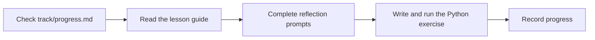

# KodNest Python Learning Track


A personal study workspace for tracking progress through a structured Python course. This repository is forked from [KodNest-V2/KodNest-Python](https://github.com/KodNest-V2/KodNest-Python); course structure and original teaching material belong to the upstream project.

## Current status

The checked-in track currently contains the welcome lesson and a progress tracker. It is a course workspace, not a standalone application or a complete Python curriculum.

## Learning workflow



## Start here

1. Review [track/progress.md](track/progress.md) for the current status.
2. Open the lesson guide at [work/README.md](track/M01-understanding-python/T01-programming-languages-and-python/M01-T01-ST01-L-welcome-to-python-track/work/README.md).
3. Write and run your response in [welcome_to_python.py](track/M01-understanding-python/T01-programming-languages-and-python/M01-T01-ST01-L-welcome-to-python-track/work/src/welcome_to_python.py).
4. Update the progress tracker when you finish.

## Repository layout

```text
track/
├── progress.md
└── M01-understanding-python/
    └── T01-programming-languages-and-python/
        └── M01-T01-ST01-L-welcome-to-python-track/
            └── work/
                ├── README.md
                └── src/welcome_to_python.py
```

When sharing or extending this fork, preserve upstream attribution and follow the original repository's license terms.
